# Legacy Pending Tasks

Derived from `docs/PROJECT_REVIEW.md`. Each task now includes a quick flow chart (Mermaid) plus example payloads/data to show the desired outcome.

## 1. Critical Security & Data Integrity

### 1.1 Harden SQL Identifier Handling
- [ ] Restrict/escape table and column names before they reach `QueryBuilder` to eliminate SQL injection.

**Flow**
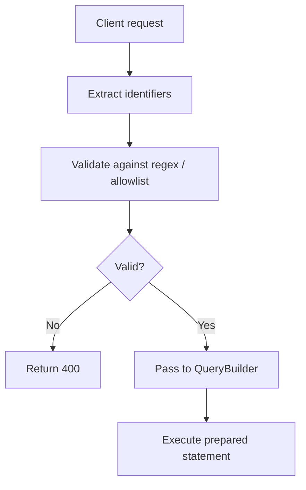

**Example Data**
```json
{
  "before": {
    "submittedTable": "rings_catalog;DROP TABLE users;",
    "columns": ["id", "price); DELETE FROM admin_log; --"]
  },
  "after": {
    "validatedTable": "rings_catalog",
    "columnWhitelist": ["id", "name", "metal", "price", "images"]
  }
}
```

### 1.2 Fix R2 Object Key Drift
- [ ] Generate the upload key once and reuse it for both D1 payloads and R2 storage.

**Flow**
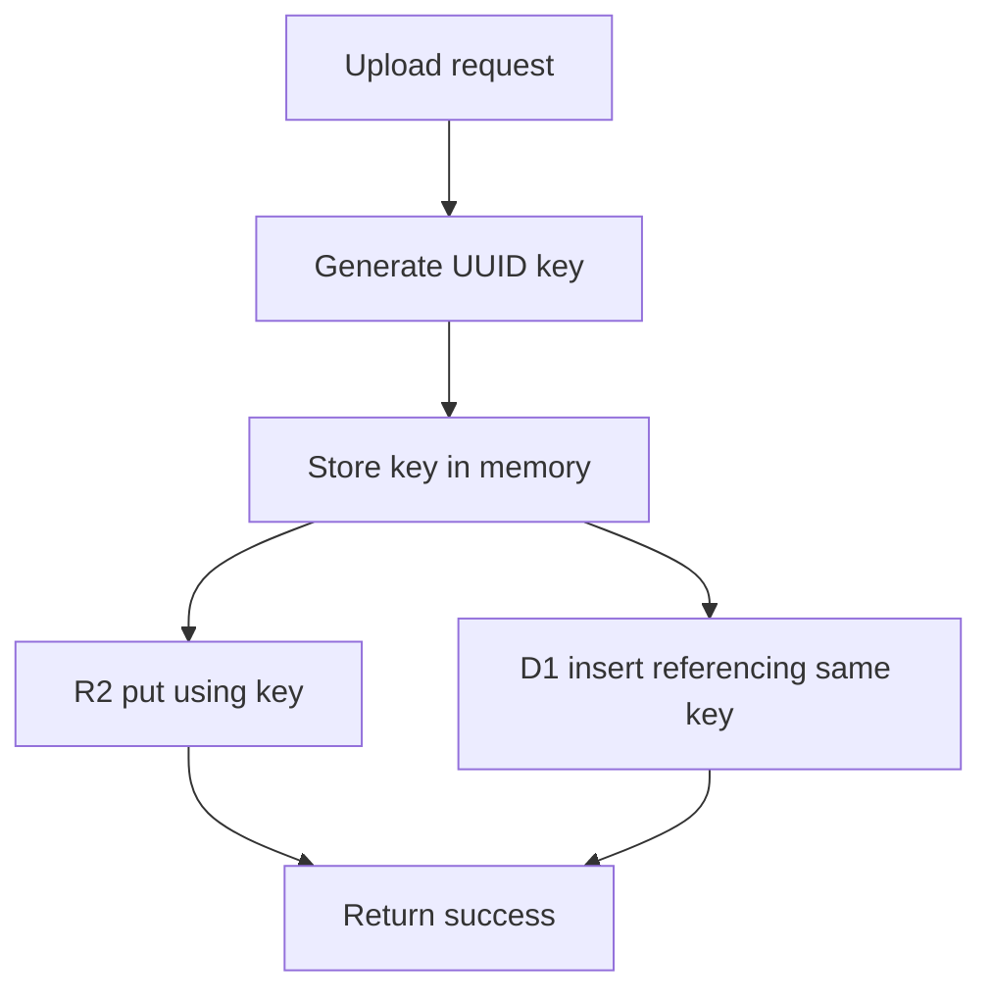

**Example Data**
```json
{
  "before": {
    "dbPath": "images/2024/08/uuid-9f1b.png",
    "r2Key": "images/2024/08/uuid-9f1c.png"
  },
  "after": {
    "key": "images/2024/08/uuid-9f1b.png",
    "r2Metadata": {"size": 482193, "contentType": "image/png"},
    "recordPayload": {"name": "Aarya Ring", "images": ["images/2024/08/uuid-9f1b.png"]}
  }
}
```

### 1.3 Restore `/api/storage/update/:key`
- [ ] Swap in a lightweight multipart parser (or pass table context) so the route reaches its handler.

**Flow**
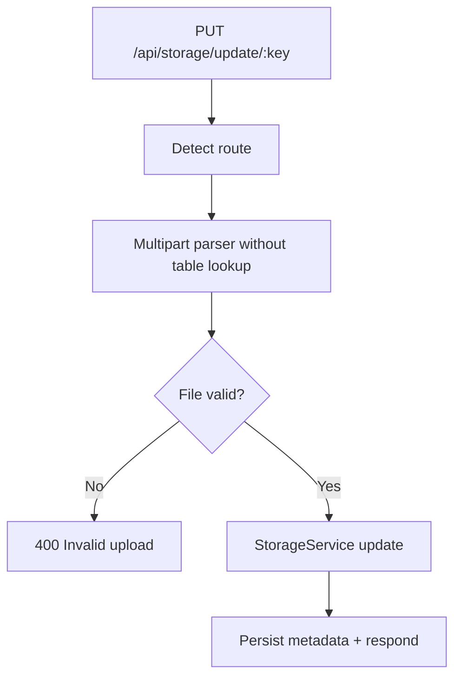

**Example Data**
```json
{
  "before": {
    "key": "hero/campaign-01.jpg",
    "error": "tableName is required for parseFormData"
  },
  "after": {
    "multipartFields": {"alt": "Autumn Campaign Hero"},
    "file": {
      "filename": "hero.jpg",
      "contentType": "image/jpeg",
      "size": 958231
    },
    "result": "storage key hero/campaign-01.jpg updated"
  }
}
```

### 1.4 Stabilize PUT Record Updates
- [ ] Replace the early `return` inside the JSON column loop with `continue` so records lacking images can still update.

**Flow**
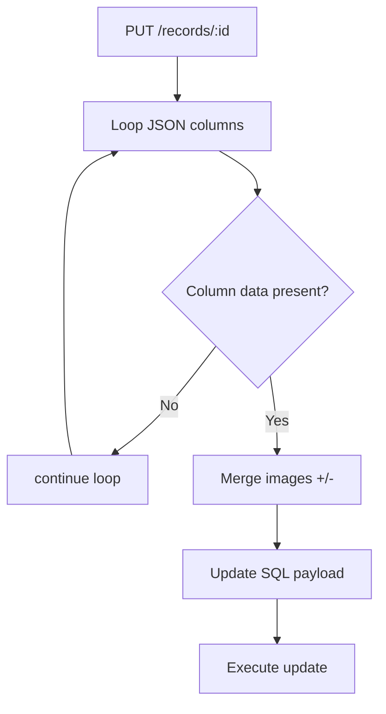

**Example Data**
```json
{
  "before": {
    "request": {"price": 135000},
    "existingRecord": {"images": null},
    "handlerResult": "returned early, no response body"
  },
  "after": {
    "request": {
      "price": 135000,
      "imagesToAdd": [],
      "imagesToRemove": []
    },
    "resultingRecord": {
      "price": 135000,
      "images": []
    }
  }
}
```

### 1.5 Add Authentication, Authorization, and Rate Limiting
- [ ] Gate every admin/storage endpoint behind signed credentials and throttling.

**Flow**
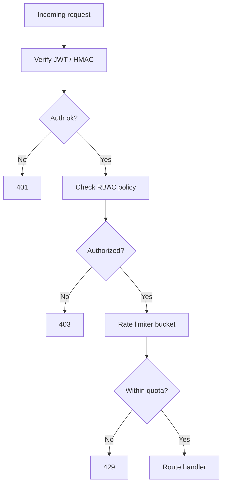

**Example Data**
```json
{
  "before": {
    "requestHeaders": {"authorization": null},
    "effect": "any user can delete tables with curl"
  },
  "after": {
    "token": "eyJhbGciOiJIUzI1NiIsInR5cCI6IkpXVCJ9...",
    "claims": {"role": "admin", "permissions": ["tables:write", "storage:write"]},
    "rateLimiter": {"bucket": "admin:monika", "limit": 1000, "remaining": 997}
  }
}
```

## 2. Platform Reliability

### 2.1 Coordinate DB ↔ R2 Operations
- [ ] Make uploads/deletes transactional or add compensating clean-up to prevent orphaned assets.

**Flow**
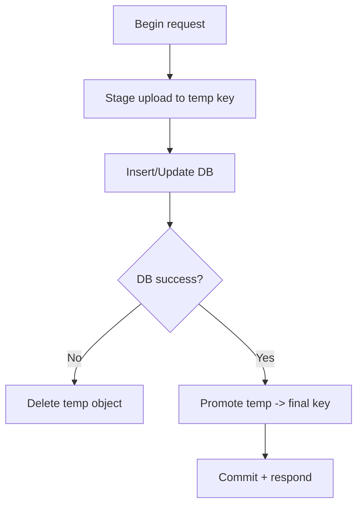

**Example Data**
```json
{
  "before": {
    "r2Key": "images/products/uuid-1234.png",
    "dbStatus": "INSERT failed",
    "orphanedFiles": ["images/products/uuid-1234.png"]
  },
  "after": {
    "tempKey": "tmp/uuid-1234.png",
    "finalKey": "images/products/uuid-1234.png",
    "dbTransactionId": "txn_78f",
    "compensatingAction": "DELETE tmp/uuid-1234.png on failure"
  }
}
```

### 2.2 Scrub Sensitive Logging
- [ ] Remove raw payload/object dumps; emit structured, redacted logs.

**Flow**
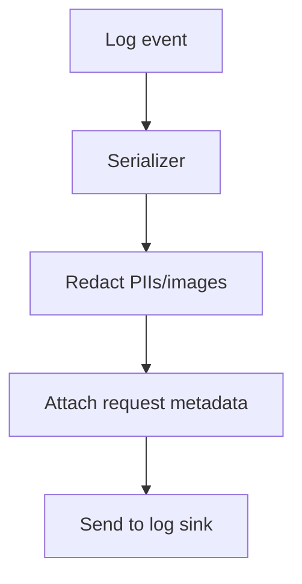

**Example Data**
```json
{
  "before": "Deleting record payload: {\"name\":\"Aarya\",\"images\":[\"...base64...\"]}",
  "after": {
    "event": "record.delete",
    "table": "rings_catalog",
    "recordId": 42,
    "redactions": ["images"]
  }
}
```

### 2.3 Honor Configuration Defaults
- [ ] Apply allowlists, payload limits, and other knobs from `src/config/app-config.js`.

**Flow**
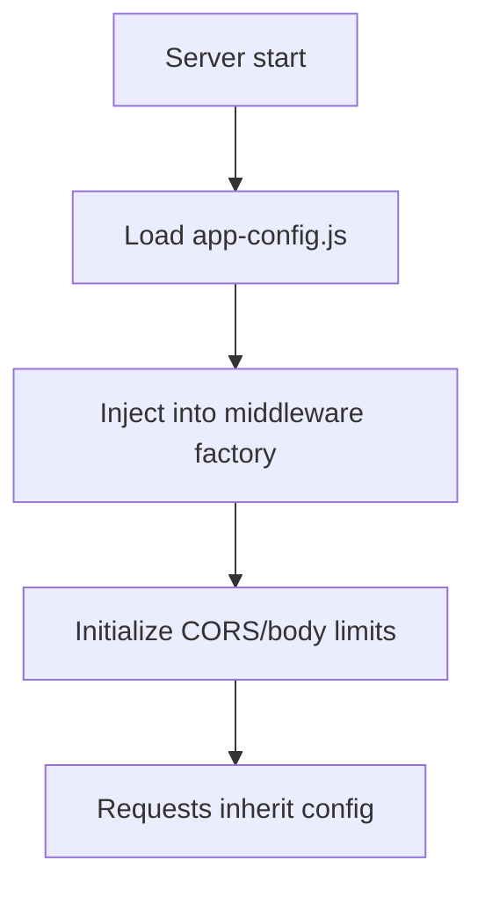

**Example Data**
```json
{
  "before": {
    "cors": {"allowedOrigins": ["*"]},
    "maxBodySize": "unbounded",
    "definedIn": "middleware/setup.js"
  },
  "after": {
    "appConfig": {
      "cors": {"allowedOrigins": ["https://admin.prjewellers.com"]},
      "maxBodySize": "10mb",
      "rateLimit": 200
    },
    "appliedTo": "src/middleware/setup.js"
  }
}
```

### 2.4 Introduce Secrets & Staging Bindings
- [ ] Split staging/prod D1 & R2 resources, add secrets management, keep local work off live data.

**Flow**
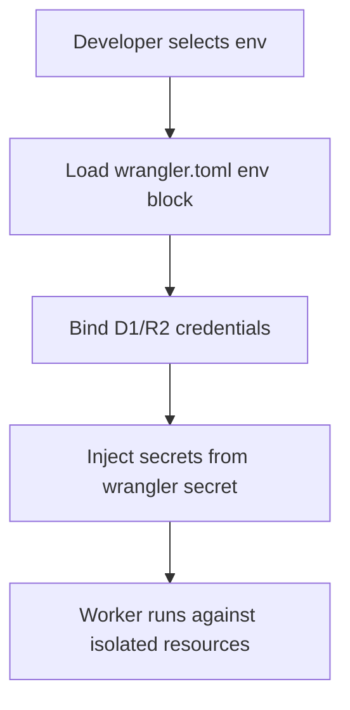

**Example Data**
```json
{
  "before": "[env.production]\\nname = \"pr-jewellers-api\"\\n[[d1_databases]]\\nbinding = \"DB\"\\ndatabase_name = \"prjewellers_prod\"",
  "after": "[env.staging]\\nname = \"pr-jewellers-api-staging\"\\n[[env.staging.d1_databases]]\\nbinding = \"DB\"\\ndatabase_name = \"prjewellers_staging\"\\n[[env.staging.r2_buckets]]\\nbinding = \"BUCKET\"\\nbucket_name = \"prjewellers-assets-staging\""
}
```

## 3. Testing & QA

### 3.1 Replace Stale Vitest Suite
- [ ] Rewrite `test/index.spec.js` and add coverage for table CRUD, multipart uploads, and negative cases.

**Flow**
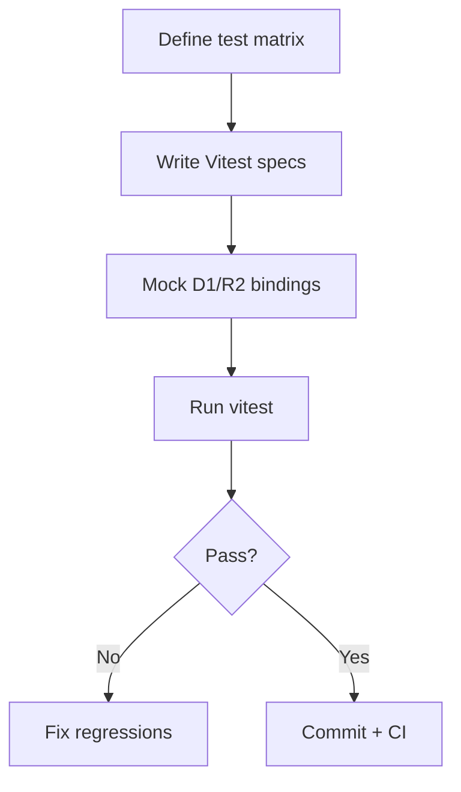

**Example Data**
```javascript
// before
test('legacy hello world', async () => {
  const res = await app.request('/');
  expect(await res.text()).toBe('Hello World!');
});

// after
test('health route', async () => {
  const res = await app.request('/api/health');
  expect(res.status).toBe(200);
  expect(await res.json()).toMatchObject({ status: 'ok' });
});
```

### 3.2 Add Integration Tests for JSON/Image Updates
- [ ] Cover no-image records, mixed additions/removals, and storage failures.

**Flow**
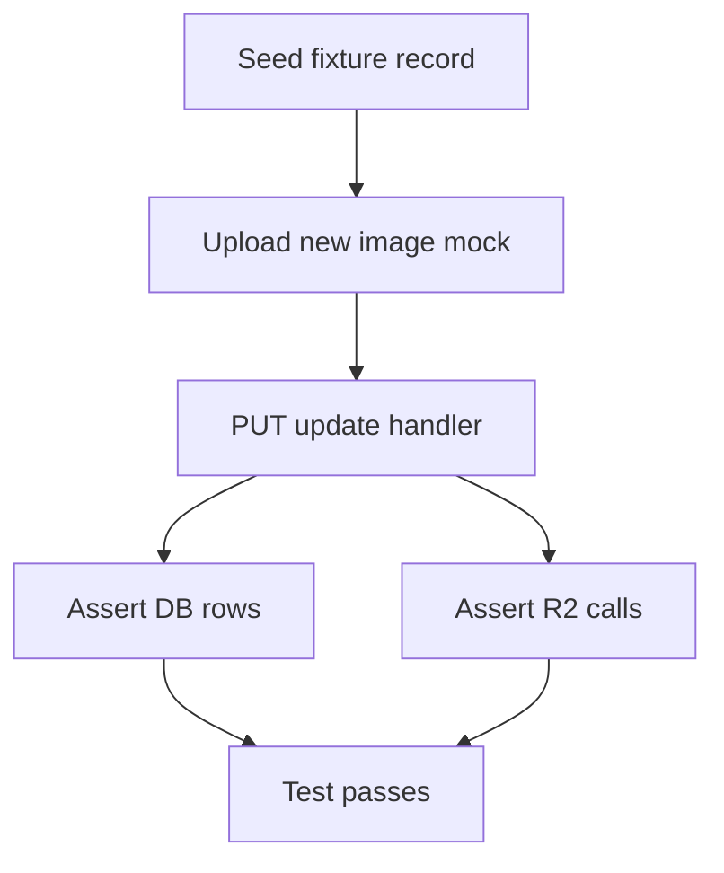

**Example Data**
```json
{
  "before": {
    "coverage": "0 integration tests",
    "bug": "records without images crash PUT route"
  },
  "after": {
    "initialRecord": {"id": 7, "images": []},
    "updatePayload": {
      "imagesToAdd": ["images/tmp/add-1.png"],
      "imagesToRemove": []
    },
    "expectedImages": ["images/tmp/add-1.png"]
  }
}
```

### 3.3 Wire CI to Run Wrangler Mocks
- [ ] Ensure every PR executes Vitest against mocked D1/R2 resources in CI.

**Flow**
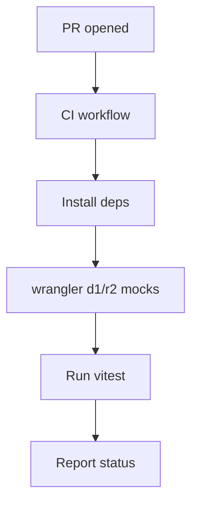

**Example Data**
```yaml
# before
steps:
  - run: npm ci
  - run: npm test # fails: missing D1 mocks

# after
steps:
  - run: npm ci
  - run: npx wrangler d1 migrations apply --local
  - run: npx vitest run
```

## 4. Domain & Feature Gaps

### 4.1 Design a Jewellery-First Schema
- [ ] Define canonical tables for products, collections, inventory, pricing, content, and appointments.

**Flow**
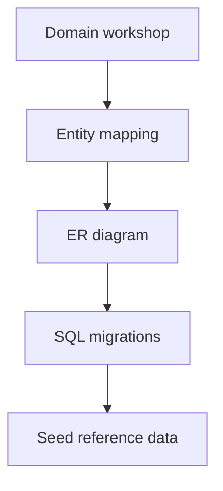

**Example Data**
```sql
-- before: ad-hoc table defined via POST /api/tables/create
CREATE TABLE "rings_catalog" (id INTEGER PRIMARY KEY, field1 TEXT, field2 TEXT);

-- after: curated jewellery schema
CREATE TABLE products (
  id INTEGER PRIMARY KEY,
  sku TEXT UNIQUE,
  name TEXT,
  collection_id INTEGER,
  metal TEXT,
  price_cents INTEGER
);
```

### 4.2 Expose Domain-Specific Endpoints
- [ ] Build `/api/products`, `/api/collections`, `/api/orders`, `/api/appointments`, etc.

**Flow**
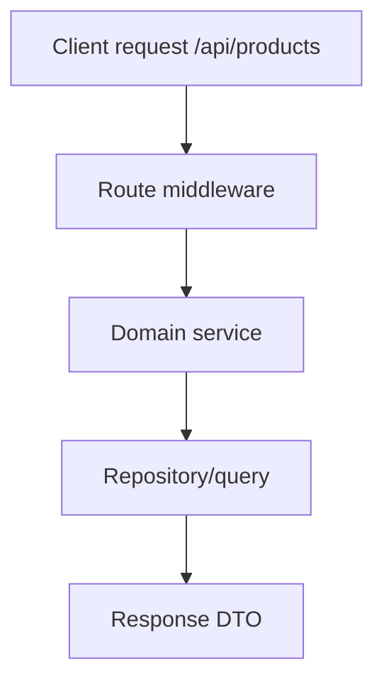

**Example Data**
```json
{
  "before": {
    "endpoint": "/api/tables/rings_catalog/records",
    "response": [
      {"id": 1, "column_0": "Aarya", "column_1": "18K", "json_0": "{\"images\":[\"...\"]}"}
    ]
  },
  "after": {
    "endpoint": "/api/products",
    "products": [
      {
        "sku": "RG-AARYA-18K",
        "name": "Aarya Solitaire",
        "price": 125000,
        "images": ["/assets/images/aarya.png"]
      }
    ]
  }
}
```

### 4.3 Implement Inventory & Availability Tracking
- [ ] Track stock counts, variant matrices, and lead times per SKU.

**Flow**
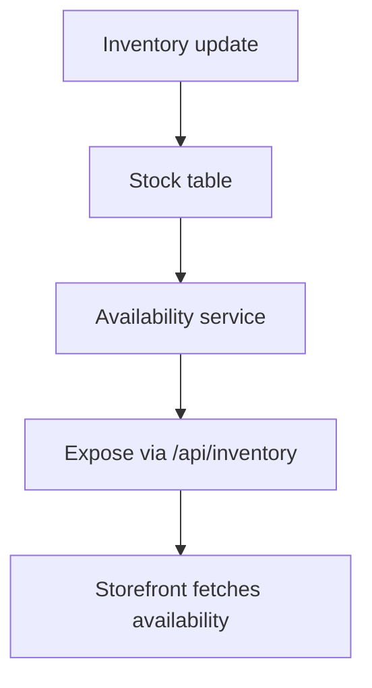

**Example Data**
```json
{
  "before": {
    "sku": "RG-AARYA-18K",
    "stock": null,
    "notes": "availability handled manually"
  },
  "after": {
    "sku": "RG-AARYA-18K",
    "variants": [
      {"size": "12", "stock": 3, "leadTimeDays": 2},
      {"size": "14", "stock": 0, "leadTimeDays": 10}
    ]
  }
}
```

### 4.4 Add Customer Experience Flows
- [ ] Implement carts, checkout, wishlists, appointments, testimonials, after-care, store locator, CMS content.

**Flow**
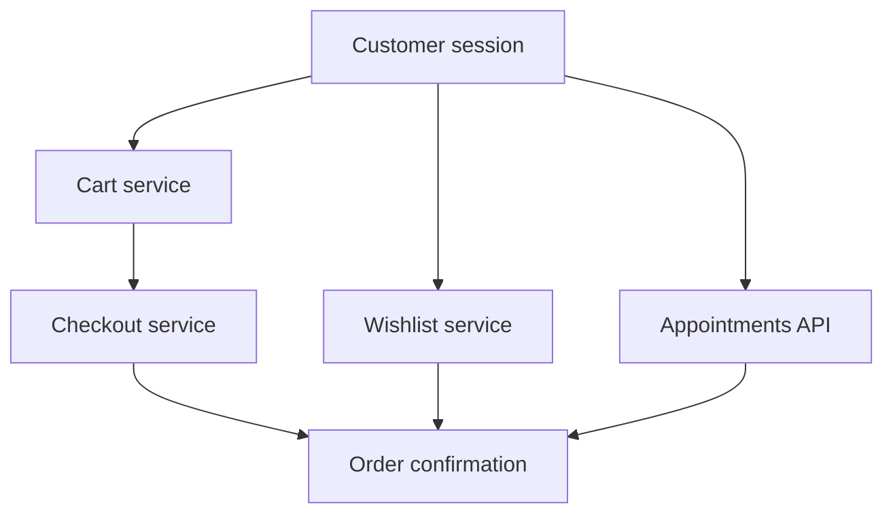

**Example Data**
```json
{
  "before": {
    "features": ["generic CRUD tables"],
    "customerFlows": "handled offline"
  },
  "after": {
    "cart": {
      "items": [
        {"sku": "RG-AARYA-18K", "qty": 1, "price": 125000}
      ],
      "currency": "INR",
      "customerId": "cust_42"
    }
  }
}
```

### 4.5 Layer Analytics & Personalization
- [ ] Capture events, conversions, recommendations, and reporting hooks.

**Flow**
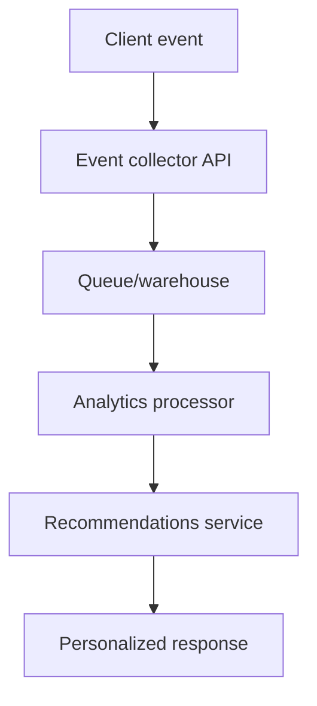

**Example Data**
```json
{
  "before": {
    "eventCaptured": false,
    "insight": "unknown conversion funnel"
  },
  "after": {
    "event": "product_view",
    "customerId": "cust_42",
    "sku": "RG-AARYA-18K",
    "timestamp": "2024-08-12T09:15:27Z",
    "context": {"device": "mobile", "referrer": "instagram"}
  }
}
```

## 5. Improvement Initiatives

### 5.1 Consolidate Image Handling
- [ ] Use UUID keys, persist mime/size metadata, consider signed URLs or stronger caching.

**Flow**
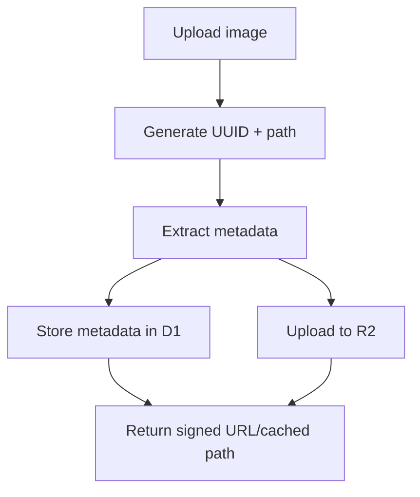

**Example Data**
```json
{
  "before": {
    "dbKey": "images/1691789010000.png",
    "r2Key": "images/1691789010123.png",
    "metadata": null
  },
  "after": {
    "uuid": "img-0f8c",
    "path": "products/2024/08/img-0f8c.jpg",
    "metadata": {"mime": "image/jpeg", "width": 2048, "height": 2048, "size": 1048576}
  }
}
```

### 5.2 Implement Identifier-Aware Validation
- [ ] Extend Zod schemas to sanitize column names, enforce max lengths, numeric types, and JSON structure.

**Flow**
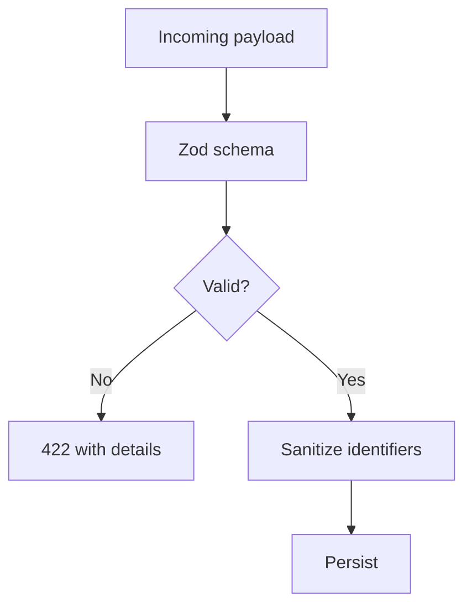

**Example Data**
```json
{
  "before": {
    "submittedColumn": "price$$$",
    "storedAs": "price$$$",
    "issue": "query builder breaks identifier"
  },
  "after": {
    "sanitizedColumn": "price",
    "validationErrors": ["name must match /^[a-z_][a-z0-9_]*$/i"]
  }
}
```

### 5.3 Add Pagination, Filtering, and Search
- [ ] Enhance `/api/tables/:tableName/records` with paging, sorting, and gemstone filters.

**Flow**
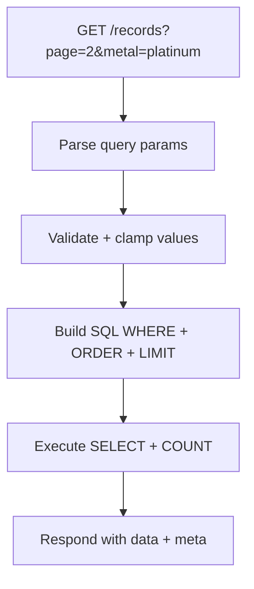

**Example Data**
```json
{
  "before": {
    "request": "/api/tables/rings_catalog/records",
    "meta": {"page": 1, "pageSize": 100, "total": 57},
    "issue": "returns entire table without filters"
  },
  "after": {
    "request": "/api/tables/rings_catalog/records?page=2&pageSize=12&metal=platinum&sort=price_desc",
    "meta": {"page": 2, "pageSize": 12, "total": 57},
    "dataSample": [{"id": 13, "name": "Navya Platinum Band", "price": 98000}]
  }
}
```

### 5.4 Plan Transactional Safety & Clean-up Workers
- [ ] Queue rollbacks or delayed deletions whenever DB or R2 operations partially fail.

**Flow**
```mermaid
flowchart TD
    A[Operation fails mid-flight] --> B[Emit cleanup job]
    B --> C[Workers Queue]
    C --> D[Cleanup worker executes]
    D --> E[Delete orphaned files/update DB]
```

**Example Data**
```json
{
  "before": {
    "failedOperation": {
      "table": "rings_catalog",
      "recordId": 51,
      "orphanedKeys": ["tmp/uuid-789.png"]
    },
    "actionTaken": "none"
  },
  "after": {
    "cleanupJob": {
      "type": "orphaned_r2_delete",
      "table": "rings_catalog",
      "recordId": 51,
      "keys": ["tmp/uuid-789.png"]
    }
  }
}
```

### 5.5 Improve Observability
- [ ] Emit structured events/metrics per route and alert on failures.

**Flow**
```mermaid
flowchart TD
    A[Request lifecycle] --> B[Instrument middleware]
    B --> C[Emit metrics/log events]
    C --> D[Metrics backend]
    D --> E[Dashboards/alerts]
```

**Example Data**
```json
{
  "before": {
    "log": "GET /api/tables ok (123ms)",
    "visibility": "best-effort console"
  },
  "after": {
    "metric": "api.request.duration",
    "tags": {"route": "/api/tables/:tableName/records", "status": 200},
    "value_ms": 123,
    "traceId": "4f3c92"
  }
}
```

## 6. Immediate Next Steps (from §9)
1. Stabilize production: implement auth, identifier sanitization, and consistent storage keys.
2. Design the jewellery schema and migrations before adding new storefront features.
3. Build customer-facing read APIs separate from admin CRUD flows.
4. Expand QA: refreshed tests + CI runners for D1/R2 mocks.
5. Operationalize deployments with staging bindings, secret management, and observability.

Update this backlog as tasks land or move to next-gen implementations.
