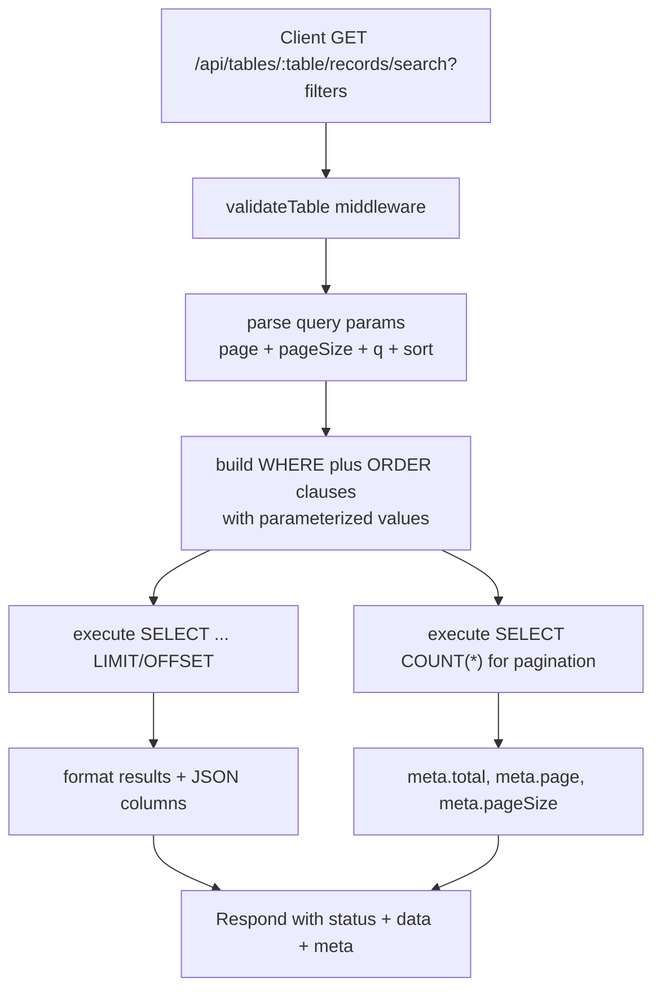

# Legacy Search Implementation Plan

This plan explains how to add simple product search/filtering to the existing (legacy) `/api/tables/:tableName/records` API without rewriting the entire backend. The goal is to let the storefront query by keyword and basic filters (metal, price range) while keeping the dynamic table model intact.

---

## 1. Scope & Assumptions
- Search applies to **one table per call** (the client still chooses `:tableName`).
- Fields to search/filter must exist in that table. Recommended convention:
  - `name` (TEXT)
  - `description` (TEXT, optional)
  - `metal` (TEXT)
  - `price` (INTEGER or REAL)
- Full-text search will use SQL `LIKE`/`LOWER` rather than an external engine. If Cloudflare D1 supports FTS5 later, we can upgrade.

---

## 2. API Design
- **Endpoint**: `GET /api/tables/:tableName/records/search`
- **Query params**:
  | Param | Type | Example | Notes |
  | --- | --- | --- | --- |
  | `q` | string | `q=solitaire` | Keyword applied to `name` and `description`. |
  | `metal` | string | `metal=18K%20gold` | Exact match (case-insensitive). |
  | `minPrice` | number | `minPrice=50000` | Greater than or equal filter. |
  | `maxPrice` | number | `maxPrice=150000` | Less than or equal filter. |
  | `page` | number | `page=1` | 1-based pagination. |
  | `pageSize` | number | `pageSize=20` | Limit per page (cap at e.g. 50). |
  | `sort` | enum | `sort=price_asc` | Allowed values: `price_asc`, `price_desc`, `name_asc`, `name_desc`, `newest`. |

Example request:
```
GET /api/tables/rings_catalog/records/search?q=aarya&metal=18K%20gold&minPrice=50000&maxPrice=200000&page=1&pageSize=12&sort=price_asc
```

Response shape mirrors existing `GET /records`, e.g.:
```json
{
  "status": "success",
  "message": "Search complete",
  "data": [
    {
      "id": 12,
      "name": "Aarya Solitaire Ring",
      "metal": "18K gold",
      "price": 125000,
      "images": ["/assets/images/123.jpg"]
    }
  ],
  "meta": {
    "page": 1,
    "pageSize": 12,
    "total": 57
  }
}
```

---

## 3. Backend Tasks

### 3.1 Middleware / Validation
1. Add a new route in `src/routes/table-routes.js`.
2. Reuse `validateTable()` middleware to ensure the table exists.
3. Create a helper to validate/sanitize query params:
   - Clamp `page` ≥ 1, `pageSize` between 1–50.
   - Cast `minPrice`/`maxPrice` to numbers; ignore if NaN.
   - Whitelist `sort` values; default to `newest`.

### 3.2 SQL Builder
Construct SQL dynamically but safely:
```sql
SELECT * FROM ${tableName}
WHERE 1=1
  AND (LOWER(name) LIKE ? OR LOWER(description) LIKE ?)
  AND lower(metal) = ?
  AND price >= ?
  AND price <= ?
ORDER BY price ASC
LIMIT ? OFFSET ?
```
Only add clauses when the filter exists; always use parameterized `bind()` values to avoid injection.

Example binding logic (pseudo):
```js
const conditions = [];
const values = [];

if (q) {
  conditions.push('(LOWER(name) LIKE ? OR LOWER(description) LIKE ?)');
  const keyword = `%${q.toLowerCase()}%`;
  values.push(keyword, keyword);
}

if (metal) {
  conditions.push('LOWER(metal) = ?');
  values.push(metal.toLowerCase());
}

if (minPrice) { conditions.push('price >= ?'); values.push(minPrice); }
if (maxPrice) { conditions.push('price <= ?'); values.push(maxPrice); }

const whereClause = conditions.length ? `WHERE ${conditions.join(' AND ')}` : '';
const sortClause = getSortClause(sort); // e.g., 'ORDER BY price ASC'
const limitClause = 'LIMIT ? OFFSET ?';
values.push(pageSize, (page - 1) * pageSize);
```

### 3.3 Counting for Pagination
Run a second query to count total matches (same WHERE clause, but `SELECT COUNT(*)`). Return the value in `meta.total`.

### 3.4 Indexes (optional but recommended)
Because tables are user-defined, we can suggest indexes if they exist:
```sql
CREATE INDEX IF NOT EXISTS idx_<table>_name ON <table>(name);
CREATE INDEX IF NOT EXISTS idx_<table>_price ON <table>(price);
CREATE INDEX IF NOT EXISTS idx_<table>_metal ON <table>(metal);
```
If we can’t modify user tables automatically, document that admins should add them for better performance.

---

## 4. Implementation Steps
1. **Route**: add `router.get('/:tableName/records/search', validateTable(), async (c) => { ... })`.
2. **Param parsing**: helper function `parseSearchParams(c.req.query())`.
3. **SQL builder**: new utility in `src/utils/query-builder.js` (e.g., `buildSearchQuery(tableName, filters)`).
4. **Database calls**: use `c.env.DB.prepare(sql).bind(...values)` for both data and count queries.
5. **JSON response**: return `{ status, message, data, meta }`, mirroring existing format.
6. **Error handling**: leverage `errorHandler` middleware for unexpected errors; return 400 for invalid params.
7. **Docs**: update README/postman collection to show example calls.

---

## 5. Testing Matrix
- `q` only → should match `name` OR `description`.
- `metal` only → case-insensitive exact match.
- Price ranges (only min, only max, both).
- Combined filters + pagination (page 2).
- Invalid params: negative page/pageSize, non-numeric minPrice, unsupported sort.
- Large tables: confirm limit/offset works and no SQL injection occurs.

Use mocked D1 data during automated tests (Vitest + `wrangler d1` mock) or run against preview DB.

---

## 6. Flow Diagram



---

## 7. Future Enhancements
- Upgrade to SQLite FTS5 when D1 supports it (true full-text search, better ranking).
- Cache common queries in Workers KV with short TTL to reduce DB load.
- Add search endpoints for specific domains (products, collections) once the next-gen schema lands.

Implementing the steps above will give the legacy storefront a pragmatic search capability without disrupting existing clients.
