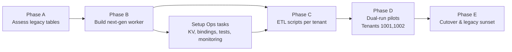

# Pending Actions – Next-Gen Migration

This file consolidates outstanding work from the previous migration, setup, and to-do documents so we can track everything in one place.

---

## 1. Migration Plan Follow-Ups (Details & Examples)
- **Phase A – Assessment**
  - Gather legacy table inventory via `wrangler d1 execute production-db --command "SELECT name FROM sqlite_master WHERE type='table';"`.
  - For each table (e.g., `rings_catalog`, `necklace_showcase`), record columns, sample rows, and which storefront feature consumes it.
  - Produce a canonical schema doc, e.g., `products(id, tenant_id, sku, name, price_amount, price_currency, metal, images[])`.
- **Phase B – Platform Build**
  - Implement `PUT /api/products/:id`, `DELETE /api/products/:id`, `GET /api/products/public` with pagination (`?page=1&pageSize=20`).
  - Add observability: log payload validation failures with request ids, emit metrics such as `products.create.latency_ms` per tenant, expose `/api/health` to report DB/R2 status.
  - Snapshot tenant registry KV nightly (e.g., `wrangler kv key list --binding=TENANT_REGISTRY > backups/tenant-registry-$(date).json`).
- **Phase C – Data Migration (ETL)**
  - Example job for tenant **1001 Raj Jewellers**:
    1. Export: `wrangler d1 execute legacy-db --command "SELECT * FROM rings_catalog" --json > exports/1001-rings.json`
    2. Transform: `node next-gen/tools/etl.js exports/1001-rings.json --tenant 1001 --map price_inr=price_amount`
    3. Validate: script checks mandatory fields, unique SKU, image paths exist.
    4. Load: call next-gen API (`curl -F "name=..." -H "X-Tenant-ID:1001" -H "X-API-Key:raj-prod-key" ...`) or run bulk inserts via D1 with the same JSON.
    5. Audit: compare counts/hashes, store report `reports/1001-migration.md`.
- **Phase D – Dual-Run Pilots**
  - Pick two clients (e.g., Tenant 1001 “Raj Jewellers”, Tenant 1002 “Aarya Couture”).
  - Switch their admin UI `.env` to `NEXT_GEN_API=https://raj.api.example.com` while keeping legacy API reachable for rollback.
  - Track KPI dashboards (e.g., product upload failures, image latency) and capture qualitative feedback from editors.
- **Phase E – Cutover**
  - Publish a freeze calendar: e.g., “Tenant 1001 freeze window June 10 00:00–04:00 IST”.
  - Steps per tenant: freeze writes → run delta ETL → verify → update DNS/routes → monitor 24h → mark legacy table read-only.
  - After all tenants migrate, run `wrangler deploy --env legacy-readonly` to keep legacy worker for read-only exports, schedule deletion date.

## 2. Setup & Operations Tasks (Examples)
- **KV + secrets**
  - Create namespace: `wrangler kv namespace create TENANT_REGISTRY`.
  - Store tenant config:
    ```bash
    wrangler kv key put --binding=TENANT_REGISTRY 1001 \
      '{"tenantName":"Raj Jewellers","dbBinding":"DB_RAJ","bucketBinding":"BUCKET_RAJ","apiKeys":["raj-prod-key"],"modules":["products"],"storagePrefix":"raj"}'
    ```
  - Rotate API keys via `wrangler secret put TENANT_1001_API_KEY` + update KV entry.
- **Bindings**
  - For staging: `wrangler d1 create raj-db-staging`, `wrangler r2 bucket create raj-images-staging`.
  - Reference names in KV so the worker pulls the correct binding per environment (dev/staging/prod).
- **Testing**
  - Mock env in Vitest:
    ```js
    const env = {
      TENANT_REGISTRY: { get: async () => JSON.stringify({ tenantName: 'Raj', dbBinding: 'DB', bucketBinding: 'BUCKET', apiKeys: ['test'] }) },
      DB: makeMockD1(),
      BUCKET: makeMockBucket(),
    };
    ```
  - Test cases: missing `X-Tenant-ID` → 400, non-numeric ID → 400, wrong API key → 401, 6th image upload → 400, duplicate SKU → 409.
- **ETL tooling**
  - `next-gen/tools/etl.js` should accept CLI flags:
    ```
    node etl.js --tenant 1001 --input exports/1001-rings.json --output payloads/1001-products.json --upload-images
    ```
  - Script re-uploads local images to `${tenant}/products/{uuid}.jpg` via R2 API, rewrites JSON to reference new URLs.
- **Pilot deployment**
  - Document fallback: set `NEXT_GEN_API` env var in tenant frontend; keep `LEGACY_API` for rollback.
  - Capture Cloudflare Workers routes mapping: e.g., `api.rajjewels.com/* -> pr-jewellers-next-gen`.
  - Add monitoring alerts (PagerDuty/Slack) scoped to pilot tenants.

## 3. Technical To-Do Items (Detailed)
- **Tenant registry data**
  - Build a CLI or small admin UI to CRUD KV entries (`npm run tenant:add --id 1003 --name "Lotus Gems" ...`).
  - Document onboarding checklist: provision bindings, create API keys, add allowed origins, share credentials.
- **Authentication hardening**
  - Introduce per-tenant rate limits (e.g., `50 req/min` for admin routes) using Workers Durable Object or KV counters.
  - Store auth failure logs with tenant id + IP for anomaly detection; plan upgrade path to JWT/HMAC signed requests.
- **Testing & local DX**
  - Provide dependency injection hooks so `StorageService` can use an in-memory mock; add npm scripts `npm run test:next-gen`.
  - Set up CI (GitHub Actions) that runs both legacy and next-gen test suites plus Wrangler typecheck.
- **Monitoring**
  - Emit metrics via Workers Analytics: latency histogram, error counts, upload sizes per tenant.
  - Configure alerts: e.g., `products.create.error_rate > 5% for 5 minutes -> alert channel`.

---

## 4. Migration Flow Overview



Use this flow to track progress—only when Phase D pilots succeed should you schedule Phase E cutovers.

Complete these items to unblock tenant pilot runs and the eventual legacy cutover.
